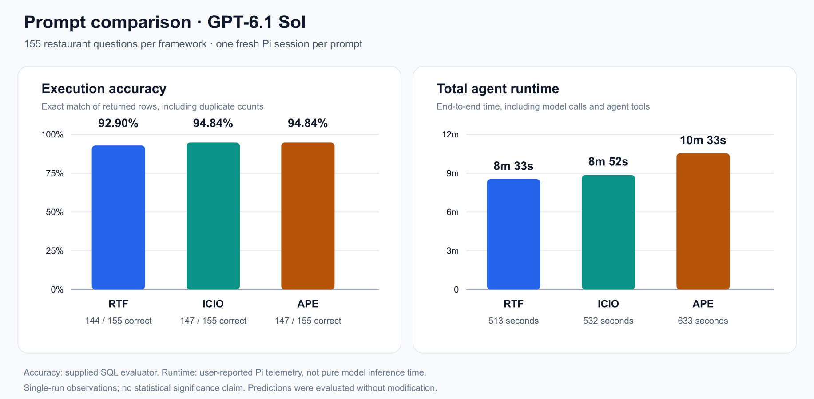

# Task 2 — Prompt Comparison

## Setup and prediction metadata

- **Model:** `openai-codex/gpt-6.1-sol` (GPT-6.1 Sol).
- **Coding agent:** Pi; one fresh session per prompting framework.
- **Task:** generate SQLite queries for the 155 questions in [restaurants_dataset.csv](data/restaurants_dataset.csv), using the supplied [schema](data/restaurants-schema.csv).
- **Output:** CSV with `question,predicted_sql`. The table below identifies the prompt and prediction file for each run.
- **Thinking level:** `max` for all three sessions, confirmed by the user.

## Evaluation and results

The original [evaluator](data/evaluate_retrieval_predictions.py) loads the database, executes each predicted SQL query and compares its returned rows with the reference results. Accuracy requires an exact match of the row multiset: row order is ignored, but duplicate counts and column order matter. It does not compare SQL strings.

All three CSVs contain exactly 155 predictions with matching question text. All queries executed successfully. Neither predictions nor the evaluator were modified during evaluation.

| Framework | Prompt file | Prediction file | Correct | Accuracy | Total agent runtime |
|---|---|---|---:|---:|---:|
| RTF | [rtf.txt](../Task_1/rtf.txt) | [prediction_rtf.csv](prediction_rtf.csv) | 144/155 | 92.90% | 8m 33s (513 s) |
| ICIO | [icio.txt](../Task_1/icio.txt) | [prediction_icio.csv](prediction_icio.csv) | 147/155 | 94.84% | 8m 52s (532 s) |
| APE | [ape.txt](../Task_1/ape.txt) | [prediction_ape.csv](prediction_ape.csv) | 147/155 | 94.84% | 10m 33s (633 s) |



ICIO and APE each answered three more questions correctly than RTF, a difference of 1.94 percentage points. ICIO matched APE's accuracy while finishing 1m 41s sooner. Incorrect predictions were executable SQL, but their results did not exactly match the references.

## Timing measurements and limitations

Times were transcribed from the user's Pi telemetry. **Total agent runtime is end-to-end latency, not pure model inference duration**: it can include multiple model calls, tool operations and stalls.

Additional reported telemetry:

| Framework | Time to first token (TTFT) | Throughput | Reported stalls |
|---|---:|---:|---:|
| RTF | Not supplied | Not supplied | Not supplied |
| ICIO | 5.1 s | 41.8 tokens/s | 6, totalling 47.9 s |
| APE | 3.9 s | 41.0 tokens/s | 4, totalling 1m 58s |

TTFT measures the delay until the first token, not the full inference duration. The aggregation of these UI metrics across model calls has not been verified; complete per-call inference timings were not collected.

There is only one run per framework, so these observations do not establish statistical significance or prove that one framework is generally better. The dataset file includes reference answers; the prompts instruct the agent to use only the question column, but this is not technical isolation of the labels. Queries must retrieve database records rather than hard-code reference answers.

## Reproducing the evaluation

Run from the repository root. This selects each prediction file in memory without editing the evaluator or copying over other files:

```bash
PYTHONDONTWRITEBYTECODE=1 python3 - <<'PY'
import sys
from pathlib import Path

base = Path('Week_03_Prompting/Assignments/Task_2').resolve()
sys.path.insert(0, str(base / 'data'))
import evaluate_retrieval_predictions as evaluator

for framework in ('rtf', 'icio', 'ape'):
    print(framework.upper())
    evaluator.PREDICTIONS_PATH = base / f'prediction_{framework}.csv'
    evaluator.main()
PY
```
