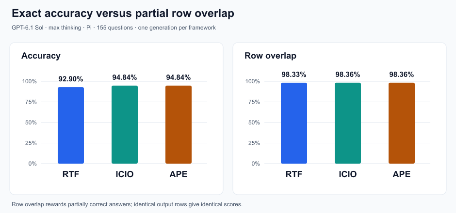

# Task 4 — Prompt Comparison

## Results

All three [prompt frameworks](../Task_1/report.md) used **GPT-6.1 Sol with max thinking**, confirmed by the user, in separate Pi sessions. There was one generation run per framework. Predictions remain unchanged.

| Framework | Exact-match accuracy | Mean row overlap |
|---|---:|---:|
| RTF | 144/155 — 92.90% | 98.33% |
| ICIO | 147/155 — 94.84% | 98.36% |
| APE | 147/155 — 94.84% | 98.36% |



The [new metric](../Task_3/report.md) gives partial credit for correctly retrieved rows while penalizing missing and extra rows. Its difference is only **0.035 percentage points**, versus 1.94 points for exact accuracy. ICIO and APE return identical row multisets for all 155 questions; RTF agrees with them on 138.

## Statistical significance

Accuracy uses an **exact paired McNemar test**. RTF wins on seven questions and loses on ten against either alternative. Row overlap uses an **exact paired sign-flip test** of the mean score difference: enumerate all `2^17` sign assignments for the 17 nonzero differences in each RTF comparison. ICIO−APE has no differences.

Use **α = 0.05** and **Holm correction across all six tests**.

| Comparison | Accuracy raw p | Overlap raw p | Holm p, both metrics |
|---|---:|---:|---:|
| RTF vs ICIO | 0.62906 | 0.94705 | 1.00000 |
| RTF vs APE | 0.62906 | 0.94705 | 1.00000 |
| ICIO vs APE | 1.00000 | 1.00000 | 1.00000 |

**No comparison is statistically significant.** These are exploratory question-level tests, not evidence that frameworks are generally equivalent: related templates and one generation per framework limit generalization and the independence/exchangeability assumptions.

## Explaining the results

- **Prompts:** RTF uses role/task/format, ICIO separates instructions and inputs, and APE adds purpose. Their underlying request is the same. None specifies which city column to use; wording and file order also differ, so this does not isolate section labels alone.
- **Model:** the same capable model at max thinking handles mostly simple SQL patterns. Similar answers are unsurprising, although this experiment cannot establish the cause of convergence.
- **Coding agent:** Pi reads the same files and produces the same CSV format. Formatting differences between SQL strings are not necessarily differences in returned answers. No recorded trace proves that agent behavior caused a framework advantage.

The clearest substantive difference is city choice: RTF generally uses LOCATION.CITY_NAME, whereas ICIO/APE use RESTAURANT.CITY_NAME. These columns disagree in **231 joined records**. Different choices match different reference answers:

| Question | RTF overlap | ICIO/APE overlap | Observation |
|---|---:|---:|---|
| #23: Alameda, rating above 2 | 100% | 98.41% | ICIO/APE add one extra row |
| #87: bay area | 97.73% | 100% | RTF misses 205 rows and adds 3, but retrieves 8,966 correct rows |
| #131: Thai food in "unknown", rating above 2.7 | 100% | 0% | ICIO/APE miss all 3 expected rows |

Overlap exposes these differences instead of treating every non-exact answer alike. Label quality also matters: unrelated question #66 expects 2,696 rows, while every model returns none. Reference answers were accessible in the dataset despite the instruction to ignore them, so generation was not technically blinded.

## Conclusion and reproduction

**No accuracy or overlap advantage was demonstrated.** Most outputs agree, and the available results do not justify ranking these frameworks. This is a valid negative finding, not a reason to manufacture differences.

```bash
PYTHONDONTWRITEBYTECODE=1 python3 Week_03_Prompting/Assignments/Task_4/analyze_results.py
```

[The analysis script](analyze_results.py) reads [saved per-question scores](../Task_3/row_overlap_results.csv), prints the paired tests and regenerates the two plots in the PNG. Statistics use the standard library; PNG rendering requires ImageMagick.

Methods: [McNemar](https://www.statsmodels.org/stable/generated/statsmodels.stats.contingency_tables.mcnemar.html), [paired sign flips](https://docs.scipy.org/doc/scipy/reference/generated/scipy.stats.permutation_test.html), [Holm](https://www.statsmodels.org/stable/generated/statsmodels.stats.multitest.multipletests.html).
