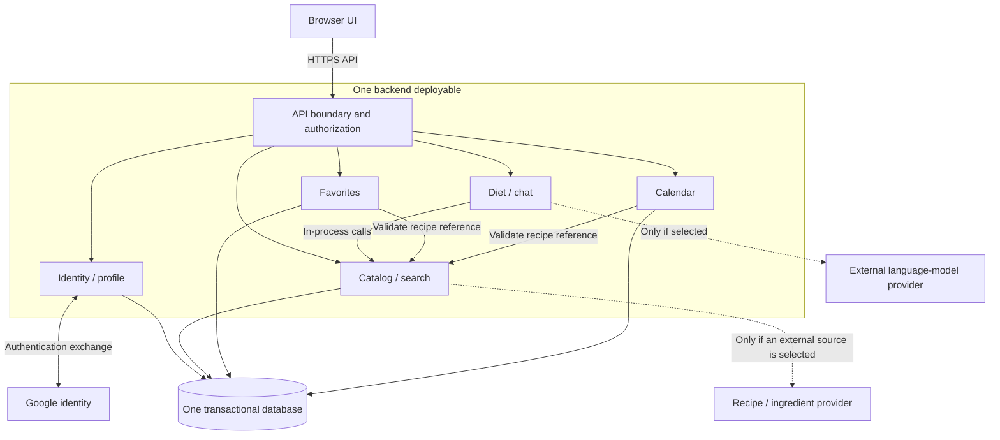

# ADR-001: Modular-monolith architecture for RecipeCove

**Status:** Accepted
**Scope:** Application architecture, module responsibilities, communication, and data ownership. Technology products and reminder-delivery behavior are not selected.

## Context

[RecipeCove requirements](Tasks/data/RecipeCove.txt) describe a web application providing public recipe-name search, recipe and ingredient information, diet-based discovery through a chatbot, Google-account registration/login, logout, profiles, private favorites, and personal calendars with recipe events.

The architectural problem is to integrate public discovery and diet/chat behavior with protected personal data, keeping calendar updates consistent and external-provider failures bounded without unnecessary distributed coordination. Logout ends the current application session while preserving the user's profile, favorites, and calendars.

Supporting sources: [architecture exploration assignment](Tasks/Task_1.md), [ADR assignment](Tasks/Task_2.md), and [discussion record](discussion_after.md).

## Decision

Use a modular monolith: a browser UI communicating with one backend deployable, organized into domain modules and backed by one transactional database. Internal calls and local transactions support catalog/chat integration and consistent personal-data changes without distributed coordination. The biggest trade-off is coupled deployment and scaling: slow chatbot or external-provider requests can affect other features unless explicitly bounded.

### Components and communication

| Component | Responsibility and data ownership |
|---|---|
| Browser UI | Search, details, chat, profile, favorites, and calendar presentation; calls backend APIs rather than accessing the database directly |
| Identity/profile module | Google identity integration, application sessions, profile data; supplies trusted authenticated user identity |
| Catalog/search module | Recipe/ingredient access, name search, structured dietary filtering, and recipe-reference validation; owns local catalog data/indexes if used |
| Diet/chat module | Conversational discovery using catalog candidates; owns conversation logic, not a separate recipe truth source |
| Favorites module | Owns private user–recipe links and their uniqueness |
| Calendar module | Owns private calendars and events; controls calendar/event transactions |
| Database | Persists application data with logical ownership by module; supports required atomic updates and uniqueness constraints |

The API boundary applies authentication where required; modules enforce private-record ownership using trusted identity, never an unverified user ID supplied by the browser. Public recipe and ingredient reads do not require ownership merely because a user references them in a favorite or event. Module interfaces mediate cross-module access; sharing a database is not permission to bypass another module's rules.

**Key flows**

1. **Login and logout:** the backend validates the Google authentication result and establishes an application session. As agreed, logout ends the current application session while preserving the user's profile, favorites, and calendars.
2. **Search and diet chat:** public browser requests reach catalog/search directly or through diet/chat. Chat uses structured diet filters and returns identifiable catalog recipes. If generation is introduced, generated prose does not replace recipe validation or dietary filtering.
3. **Add a favorite:** derive the user from the session, validate the recipe reference, and insert the private link with a unique user/recipe constraint. Repeated additions do not create duplicates.
4. **Create a calendar or add an event:** create the calendar for the authenticated user; for an event, check calendar ownership and validate the recipe reference before committing. Use an idempotency key to recognize retries after a lost response, so one intended creation produces one event.
5. **Delete a calendar:** verify ownership and delete its events and calendar in one transaction. Failure rolls back the whole change. Removing private links must remain possible even when their referenced public recipe becomes unavailable.

## Alternatives considered

| Criterion | Modular monolith — selected | Serverless / managed backend — not selected | Domain services — not selected |
|---|---|---|---|
| Deployment | One backend plus database | Functions, managed identity/database, access policies | Multiple services with owned data stores |
| Calendar consistency | One database transaction | Depends on selected store's transactions | Local personal-data transaction; recipe references cross service boundaries |
| Security focus | Session and module ownership checks | Database policies plus function authorization | Gateway identity plus service authorization |
| Chat failure isolation | Shared runtime; constrain concurrency | Separate functions subject to provider limits | Separate service; prevent cascading failures |
| Independent change/scaling | Modules release and scale together | Functions can scale separately within provider model | Services scale/deploy separately with API coordination |
| Main ongoing burden | Module boundaries and shared-runtime health | Policy tests, quotas, integration and provider recovery | Network failures, tracing, API compatibility and distributed data |

Managed services could reduce infrastructure administration, but no evidence yet shows that their policy and integration costs are preferable. Domain services could benefit independent teams or distinct workloads, but those conditions are not established. These are not exclusive technology categories: the selected monolith may use managed infrastructure without becoming a browser-to-BaaS design.

## Consequences and implementation difficulties

- **Simpler consistency and communication:** calendar deletion and personal-data writes use local transactions; catalog and chat collaborate through in-process calls. Implementing ownership checks, transaction boundaries, uniqueness, and retry handling remains necessary.
- **Coupled runtime:** slow external calls can exhaust shared backend resources. Bound timeouts and concurrent calls, avoid keeping database transactions open during provider requests, and return explicit unavailable responses. A provider timeout must not be reported as a nonexistent recipe.
- **Module erosion:** direct access to another module's tables can create hidden dependencies. Define interfaces and enforce boundaries through code review and focused tests.
- **Catalog integrity:** unavailable or removed recipes can leave saved references. Private records must remain removable; detail views should explain unavailable references. Dietary results depend on ingredient-data quality and must not imply medical-safety guarantees.
- **Operations remain required:** log request IDs and module/provider failures without exposing private data, monitor shared-runtime saturation, and test database backup restoration. A single deployable does not remove operational responsibility.
- **Conditional scheduling:** calendar event persistence alone does not establish notification delivery. If delivery is later required, evaluate scheduling, retries, and duplicate-delivery handling before adding background infrastructure.

## Unresolved choices

- **Reminder delivery:** explicitly unspecified by the user. Do not assume email, push notifications, or that displaying an event fully satisfies the reminder requirement.
- **Calendar semantics:** date-only versus timed events, timezone handling, and any calendar-count constraints require clarification.
- **Catalog source:** local ingestion versus live lookup, recipe/ingredient provider, licensing, stable identifiers, update/deletion behavior, and required information completeness.
- **Search and diet semantics:** matching/ranking, supported diets, treatment of missing ingredient information, chatbot interaction expectations, and whether an LLM is needed.
- **Technologies:** database product, backend/frontend frameworks, session mechanism, hosting, and any provider other than the required Google identity integration. The database must support the required transaction and uniqueness behavior; no product is selected.
- **Operating constraints:** traffic, availability goals, team expertise, budget, and deployment restrictions. These are unknown rather than inferred from the assignment.

## Validation and reconsideration

These are proposed future checks, not completed tests:

- Confirm public recipe/ingredient discovery works without login and private data cannot be accessed or changed by another user.
- Exercise duplicate favorite requests, retried event creation, and calendar-deletion failures; verify uniqueness, idempotency, and rollback.
- Simulate recipe/chat provider timeouts; verify bounded failure behavior, usable unrelated features, and removal of stale private references.
- Check diet suggestions against catalog filters and verify a database restore recovers profiles, favorites, calendars, and events.
- Confirm reminder and time semantics before treating calendar behavior as complete.

Reconsider serverless composition if demonstrated platform expertise and compatible database/runtime capabilities justify it. Reconsider service extraction if observed chat workload, isolation requirements, or independent team ownership make shared deployment a material constraint. Establish measurable workload and availability targets before making performance or cost claims.
